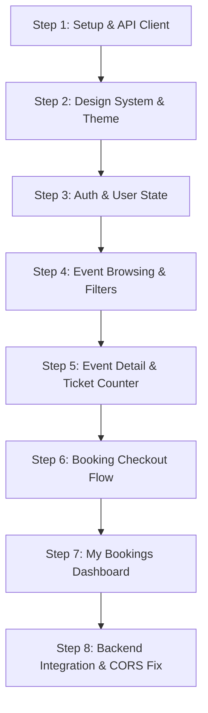

## Complete Step-by-Step Frontend Roadmap

Follow this step-by-step roadmap to build a modern, high-performance, and visually stunning frontend for **Tixora**.

---

### 🌐 Recommended Tech Stack

| Layer | Tool / Library | Reason |
| :--- | :--- | :--- |
| **Framework** | Next.js 14+ (App Router) or Vite + React | High performance, SEO friendly, fast routing |
| **Language** | TypeScript | Strong typing matching Go backend DTOs |
| **Styling** | Vanilla CSS / CSS Modules | Clean, custom visual design, smooth animations |
| **Icons & Fonts** | Lucide React + Google Fonts (Inter/Outfit) | Modern iconography and typography |
| **State Management**| Zustand / TanStack Query (React Query) | Efficient API fetching, caching, and auth state |
| **HTTP Client** | Axios | Easy interceptors for attaching JWT headers |
| **Notifications** | Sonner / React Hot Toast | Beautiful toast feedback on user actions |

---

### 🗺️ Step-by-Step Execution Plan



---

### 🔹 Step 1: Project Initialization & API Client Setup

1. **Create the Frontend App:**
   ```bash
   npx create-next-app@latest frontend --typescript --eslint --app
   ```
2. **Define API Types matching Go DTOs (`src/types/api.ts`):**
   ```typescript
   export interface User {
     id: number;
     name: string;
     email: string;
     token?: string;
     created_at: string;
   }

   export interface Event {
     id: number;
     title: string;
     description: string;
     location: string;
     starts_at: string;
     total_tickets: number;
     available_tickets: number;
     price: number;
     created_at: string;
   }

   export interface Booking {
     id: number;
     user_id: number;
     event_id: number;
     quantity: number;
     total_price: number;
     status: 'confirmed' | 'cancelled';
     booking_code: string;
     created_at: string;
   }
   ```

3. **Configure Axios Client (`src/lib/api.ts`):**
   - Base URL pointing to `http://localhost:8080/api/v1`
   - Add Request Interceptor to automatically attach `Authorization: Bearer <token>` from `localStorage` or Cookies.

---

### 🔹 Step 2: Global Design System & Theme Configuration

1. **Setup Custom Color Tokens (`src/app/globals.css`):**
   - Dark Mode / Modern Aesthetic (Deep Slate Navy `#0F172A`, Accent Neon Purple `#8B5CF6`, Vibrant Cyan `#06B6D4`, Glassmorphism cards with `backdrop-filter: blur(12px)`).
2. **Create Core UI Components:**
   - `Button`: Primary, Secondary, Outline, Loading states with spinners.
   - `Navbar`: Sticky frosted glass header with navigation links, search bar, and User Avatar dropdown.
   - `Modal`: Generic backdrop blur dialog for ticket booking and confirmation.
   - `Badge`: Status tags (`Available`, `Sold Out`, `Confirmed`, `Cancelled`).
   - `Input` & `FormGroup`: Floating labels and clean error state displays.

---

### 🔹 Step 3: Authentication System (Login & Register)

1. **Create Auth Context / Store (`src/store/useAuthStore.ts`):**
   - Store `user`, `token`, `isAuthenticated`, `login()`, `logout()`, `fetchMe()`.
2. **Build Pages:**
   - **Login Page (`/login`):** Email & Password fields with live client-side validation.
   - **Register Page (`/register`):** Full Name, Email, Password & Confirm Password.
3. **API Integration:**
   - Call `POST /api/v1/auth/register` and `POST /api/v1/auth/login`.
   - On success: save JWT token, redirect to home page, show success toast.
   - On mount: call `GET /api/v1/auth/me` to restore login state automatically.

---

### 🔹 Step 4: Event Browsing & Home Page (`/`)

1. **Hero Section:**
   - Eye-catching banner: *"Discover & Book Exclusive Events Nationwide"*.
   - Live Search Input (filters events by title or location).
2. **Event Grid:**
   - Responsive grid (1 col mobile, 2 col tablet, 3 col desktop).
   - Event Card showing image/graphic, Date/Time, Location badge, Price, and Ticket Availability indicator (`x tickets left`).
3. **API Integration:**
   - Call `GET /api/v1/events` to populate the grid.
   - Add skeleton loaders while fetching data.

---

### 🔹 Step 5: Event Details Page (`/events/[id]`)

1. **Detailed Layout:**
   - Event Title, Description, Date & Time, Venue Location.
   - Live availability counter progress bar (`AvailableTickets / TotalTickets`).
2. **Interactive Ticket Counter:**
   - `+` and `-` quantity selector capped at `AvailableTickets`.
   - Real-time Total Price calculation (`Quantity * Price`).
3. **Book Ticket Button:**
   - Opens checkout confirmation modal or triggers instant booking if logged in.
   - Redirects to `/login` if user is unauthenticated.

---

### 🔹 Step 6: Booking & Ticket Purchase Flow

1. **Booking Modal / Drawer:**
   - Summary of selected event, quantity, price per ticket, total cost.
   - *"Confirm Booking"* CTA button with loading indicator.
2. **API Integration:**
   - Call `POST /api/v1/bookings` with `{ event_id, quantity }`.
3. **Success Confirmation Modal:**
   - Displays uniquely generated `booking_code` (e.g. `GT-XXXX-XXXX`).
   - Quick button to view ticket in "My Bookings" or download ticket summary.

---

### 🔹 Step 7: User Dashboard - "My Bookings" (`/my-bookings`)

1. **User Ticket List:**
   - Display all user bookings fetched from `GET /api/v1/bookings/me`.
   - Card layout with QR Code / Booking Code badge, status, date of purchase, total price.
2. **Filters & Search:**
   - Filter by status (`Confirmed`, `Cancelled`).
3. **Action Buttons:**
   - Option to print/view ticket details.

---

### 🔹 Step 8: Backend Fixes Required for Seamless Integration

Before connecting the frontend, apply these quick fixes in your Go backend:

1. **Enable CORS in `internal/server/http.go`:**
   ```go
   import "github.com/labstack/echo/v5/middleware"

   e.Use(middleware.CORSWithConfig(middleware.CORSConfig{
       AllowOrigins: []string{"http://localhost:3000", "http://localhost:5173"},
       AllowHeaders: []string{echo.HeaderOrigin, echo.HeaderContentType, echo.HeaderAccept, echo.HeaderAuthorization},
   }))
   ```
2. **Fix Event Update DTO & Service:**
   - Add `TotalTickets int \`json:"total_tickets" validate:"omitempty,gt=0"\`` to `dto.UpdateRequest`.
   - Update `service.UpdateEvent()` to safely recalculate `AvailableTickets`.

---

## 🛠️ Summary Checklist

- [ ] Add CORS middleware in Go backend (`http.go`)
- [ ] Initialize frontend workspace with TypeScript & Axios
- [ ] Implement Auth flow (`/login`, `/register`, `/me`)
- [ ] Build Event Marketplace (`/`, `/events/:id`)
- [ ] Build Ticket Purchase & Booking Flow (`/api/v1/bookings`)
- [ ] Build User Dashboard (`/my-bookings`)
