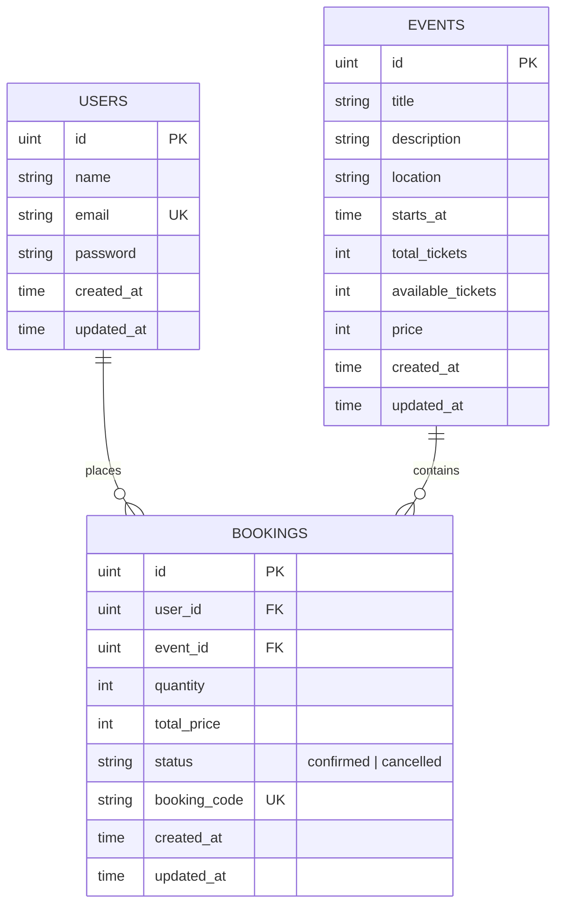

#  Tixora - Event Ticketing & Booking RESTful API Backend

[](https://golang.org)
[](https://echo.labstack.com)
[](https://gorm.io)
[](https://neon.tech)
[](LICENSE)


## About

Tixora is a **Backend Microservice / Monolith Core API** designed specifically for real-time ticket sales and event booking systems. It provides complete user authentication, event publishing & management, and real-time ticket inventory reservation.

It solves one of the hardest problems in ticket reservation software: **Overbooking caused by simultaneous concurrent requests (race conditions)**. By enforcing pessimistic row-level database locking (`SELECT ... FOR UPDATE`) within SQL transactions, Tixora guarantees that ticket counts remain exact even under peak traffic burst conditions (e.g., high-demand concert or conference ticket launches).

---

##  Key Features

- ** User Management & Authentication:**
  - Secure Registration & Login with Bcrypt password hashing.
  - Stateless JWT (JSON Web Tokens) authentication with configurable secret keys.
  - Protected endpoints secured by custom Echo middleware (`/me`, `/bookings`).

- ** Event Lifecycle Management:**
  - Create, view, update, and delete events (title, description, location, timing, pricing).
  - Dynamic ticket inventory tracking (`total_tickets` vs `available_tickets`).
  - Search and filter public events.

- ** Transaction-Safe Booking System:**
  - Race-condition proof ticket reservation engine using PostgreSQL row locking (`FOR UPDATE`).
  - Auto-generation of unique alphanumeric booking confirmation codes (`GT-<UUID>`).
  - Real-time total price calculation.
  - **Booking Cancellation & Ticket Restoration:** Cancelling a booking instantly restores tickets back to the available event pool inside a database transaction.


- **Request Validation & Error Handling:**
  - Built-in struct validation powered by `go-playground/validator/v10`.
  - Standardized JSON HTTP error responses (`httpresponse.ErrorResponse`).
  - Global Echo logging and CORS middleware enabled out of the box.

---

##  Tech Stack & Frameworks

| Domain | Technology / Library | Purpose & Description |
| :--- | :--- | :--- |
| **Language** | **Go (Golang)** `1.22+` / `1.26` | High concurrency, strong typing, compiled performance |
| **Web Framework** | **Echo v5** (`github.com/labstack/echo/v5`) | High-performance, lightweight HTTP router & web framework |
| **ORM & Database** | **GORM v1.31** + **PostgreSQL** | Object-Relational Mapping with NeonDB cloud PostgreSQL support |
| **Authentication** | **Golang JWT v5** (`golang-jwt/jwt/v5`) | Token generation, claims parsing, and auth verification |
| **Security** | **x/crypto/bcrypt** | Industry-standard password hashing and salting |
| **Validation** | **Validator v10** (`go-playground/validator/v10`) | Structural request payload DTO validation |
| **Configuration** | **godotenv** (`joho/godotenv`) | Automatic `.env` file environment variable loading |
| **Identifiers** | **Google UUID** (`google/uuid`) | Cryptographically secure unique booking code generation |
| **Live Reloading** | **Air** (`.air.toml`) | Instant hot-reloading during backend development |

---


##  Project Architecture & Folder Structure

Tixora follows **Domain-Driven Design (DDD)** and **Clean Architecture** patterns:

```text
Tixora/
├── cmd/
│   └── main.go               # Application entry point
├── internal/
│   ├── auth/                 # JWT token creation & parsing logic
│   ├── config/               # Environment loader (.env) & GORM database connection
│   ├── domain/               # Core business domains (DDD)
│   │   ├── user/             # User domain (Entity, DTO, Repository, Service, Handler, Routes)
│   │   ├── event/            # Event domain (Entity, DTO, Repository, Service, Handler, Routes)
│   │   └── booking/          # Booking domain (Transactional logic, Locking, Cancellation)
│   ├── httpresponse/         # Standardized error & HTTP response formatters
│   ├── middlewares/          # JWT Auth Middleware & Request interceptors
│   └── server/               # Echo HTTP server setup & route registration
├── .air.toml                 # Air hot-reloading configuration
├── .env                      # Local environment variables configuration
├── go.mod                    # Go module dependencies declaration
└── go.sum                    # Dependency checksums lockfile
```

---

##  Database Schema & Entities

The application automatically creates and migrates three main tables via GORM `AutoMigrate`:



---

##  Concurrency & Race Condition Handling

When multiple users attempt to purchase remaining tickets simultaneously, a naive implementation creates a race condition where available tickets drop below zero.

Tixora prevents this at the database level by opening a **GORM SQL Transaction** with **Pessimistic Row-Level Locking**:

```go
// Excerpt from internal/domain/booking/repository.go
err := r.db.Transaction(func(tx *gorm.DB) error {
    var eventData event.Event

    // Lock the event row for UPDATE until transaction commits
    err := tx.Clauses(clause.Locking{Strength: "Update"}).First(&eventData, eventId).Error
    if err != nil {
        return err
    }

    // Verify availability within locked state
    if eventData.AvailableTickets < quantity {
        return ErrNotEnoughTickets
    }

    // Deduct tickets and save booking atomically
    eventData.AvailableTickets -= quantity
    tx.Save(&eventData)
    return tx.Create(&booking).Error
})
```
